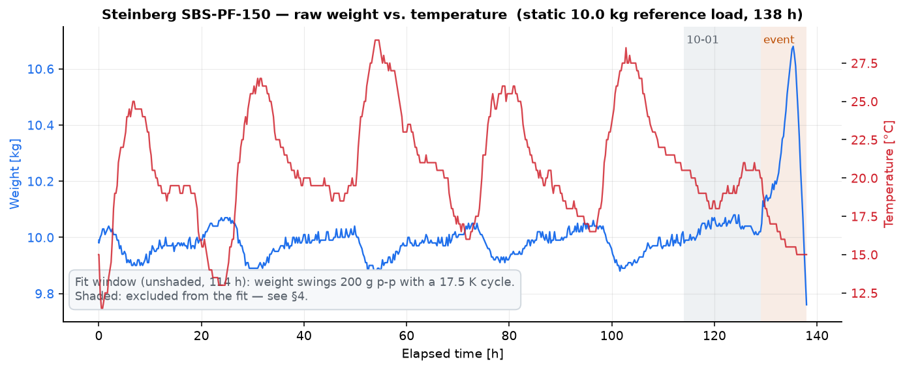
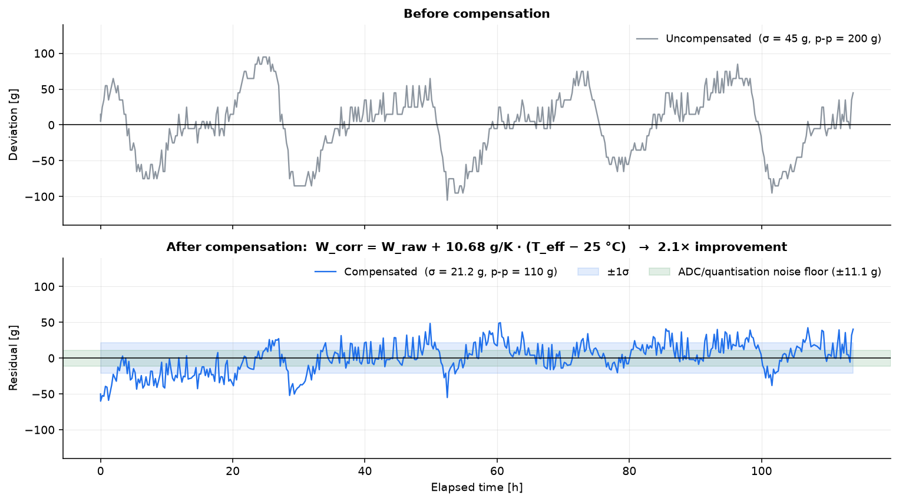
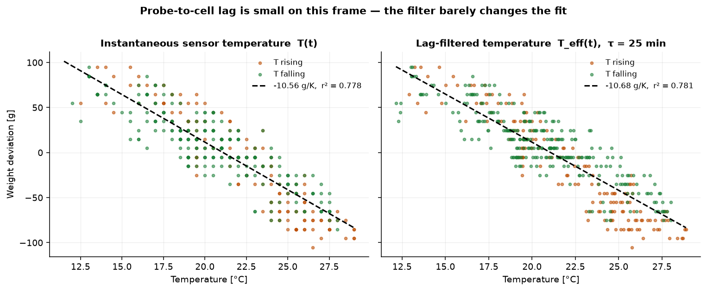
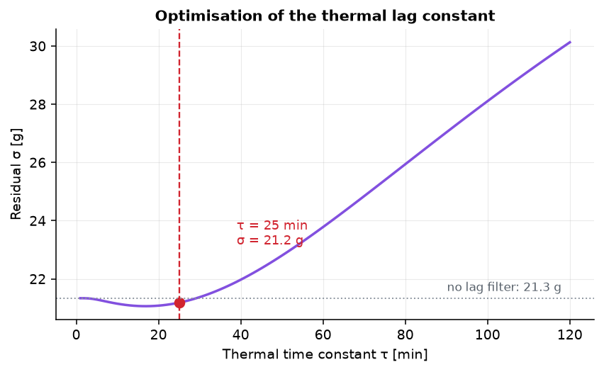
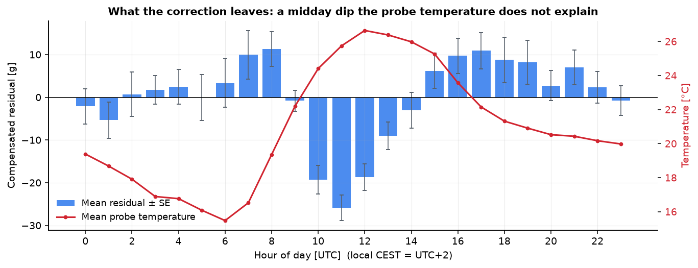
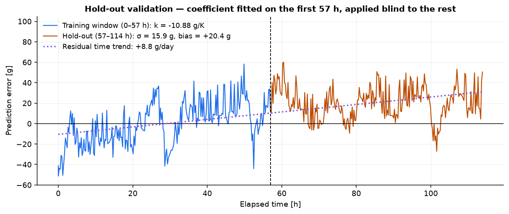
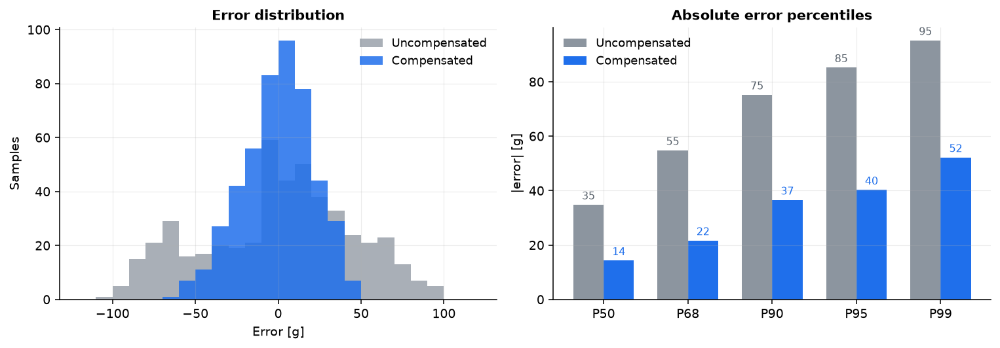
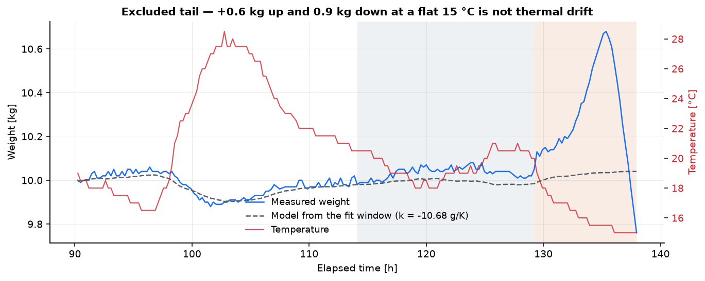

# Temperature Drift Characterisation — Steinberg SBS-PF-150

**Project:** TANEN BASE · open-source hive monitoring
**Device under test:** Steinberg `SBS-PF-150` single-point load cell (E<sub>max</sub> = 150 kg), in its TanenBase frame, outdoors
**Measurement period:** 2026-09-26 05:54 UTC → 2026-10-01 23:54 UTC (138 h); **fit window** 09-26 05:57 → 09-30 23:49 (113.9 h, 5 daily cycles)
**Samples:** 582 uplinks @ 14.2 min, 481 in the fit window
**Load:** ~10.0 kg of water, static
**Method:** production week — weight and probe temperature as uplinked by the node, load-cell profile 0 (generic, gain 0 — so the log is raw) ([`../README.md`](../README.md) § *Characterising a cell from a production week*)
**Raw data:** [`data/SBS-PF-150.csv`](data/SBS-PF-150.csv)
**Reproduce:** `python analysis/tempcomp_analysis.py`
**Field validation:** **pending** — see §8

---

## TL;DR

Uncompensated, the cell reports a **200 g peak-to-peak swing on a constant 10 kg load** over a 17.5 K daily temperature cycle: 10.7 g of phantom weight per kelvin — same sign as the H40A, 60 % of its magnitude.

The same two-parameter correction as the H40A reduces the error to **σ = 21.2 g**, a 2.1× improvement, about 1.9× the 11 g noise floor.

```
W_corr = W_raw + 10.68 g/K · (T_eff − T_ref)
T_eff[n] = T_eff[n−1] + α · (T[n] − T_eff[n−1]),   τ = 25 min
```

This ships as load-cell profile `2` (`LC_PROFILE_SBS_PF`): **10681 mg/K, 1500 s**. No beekeeper action — units already set to *Steinberg SBS-PF-150* pick it up with the firmware update (§6).

The improvement is smaller than the H40A's 6.5× for two reasons that are not the correction's fault: the raw drift is smaller to begin with, and what is left is a **midday dip the probe does not see** (§3) plus a **+9 g/day trend** (§4) — neither of which a temperature correction can or should remove.



---

## 1. Results

Fit window, 481 samples, 11.5–29.0 °C.

| Metric | Uncompensated | Compensated | Improvement |
|---|---:|---:|---:|
| Std deviation σ | 45.3 g | **21.2 g** | 2.1× |
| Peak-to-peak | 200 g | **110 g** | 1.8× |
| P95 absolute error | 85.2 g | **40.2 g** | 2.1× |
| Relative to 150 kg FS (σ) | 0.030 % | **0.014 %** | — |

**Fitted model coefficients**

| Parameter | Value | Note |
|---|---|---|
| `k` (temperature coefficient) | **−10.681 g/K** | 95 % CI ± 0.507 g/K |
| `τ` (thermal time constant) | **25 min** | kept from the H40A; anything 1–41 min is within 1 g (Fig. 3) |
| `T_ref` | 25 °C | arbitrary for the fit; the firmware uses the tare temperature |
| `r²` | 0.781 | T<sub>eff</sub> vs. W |
| Noise floor | 11.1 g | sample-to-sample, includes 10 g quantisation of the uplink |

**Sensitivity to the window.** The fitted `k` moves with where the window is cut, all within ~±0.5 g/K of the shipped value:

| Window | `k` | σ |
|---|---:|---:|
| **09-26 05:57 → 10-01 00:00 (shipped)** | **−10.68 g/K** | 21.2 g |
| first day dropped, 09-27 00:00 → 10-01 00:00 | −11.38 g/K | 18.4 g |
| 10-01 day included, → 10-01 15:00 | −11.27 g/K | 25.0 g |
| fit window + linear time term (diagnostic only, §4) | −11.58 g/K | 17.3 g |

Over the 17.5 K span a 0.9 g/K disagreement is ≤ 16 g — inside the compensated σ. Not worth chasing before a field validation (§8).



---

## 2. Thermal lag is negligible on this frame

On the H40A the filter was doing real work: the weight-vs-temperature loop was 26 g wide and collapsed to 1.2 g at τ = 25 min. Here there is **no loop to collapse**. Against the instantaneous probe temperature the rising and falling branches already sit within 0.5 g of each other, and the τ sweep is nearly flat: no filter 21.3 g, best (τ = 17 min) 21.1 g, τ = 25 min 21.2 g.



So the probe and the cell body track each other closely on this build. τ is kept at **1500 s** anyway: it costs 0.1 g against the optimum, every other profile carries it, and a frame with worse probe coupling is protected rather than penalised. Above ~40 min the filter starts to hurt.



---

## 3. What the correction leaves: a midday dip

Binning the compensated residual by hour of day shows the structure behind the 21 g:



- **10–13 UTC (12–15 local): −19 to −26 g.** The cell reads *lighter* than the probe temperature predicts — as if it were ~2 K warmer than the probe.
- **07–08 and 15–19 UTC: +8 to +11 g.** The opposite, on the shoulders of the day.

A lag cannot produce this: a lag gives opposite-sign residuals on the rising and falling flanks, whereas here both flanks are positive and the peak is negative. This is a **heat input the probe does not see** — most likely direct sun on the cell or the metal frame while the probe sits in shade, or the reverse. It is the H40A report's §7 item 2 again: **the probe needs to be on the cell body**, and shading the cell side of the frame would help just as much.

---

## 4. Hold-out validation

The coefficient was fitted on the first 57 h only and applied blind to the remaining 57 h.

- `k` fitted on training window: **−10.884 g/K** vs. −10.681 g/K on the full window → stable to 2 %, not overfitted.
- Hold-out scatter: **σ = 15.9 g**
- Hold-out bias: **+20.4 g**, growing linearly



The bias is a **+8.8 g/day linear trend** that survives temperature compensation — the same phenomenon as the H40A's −22.6 g/day, with the opposite sign. The load is water, and its sign rules out evaporation, which would show as a *loss*. That leaves dew or moisture taken up by the platform and the container on autumn nights, creep, or slow drift in the bridge/ADC. Not resolvable from this dataset.

As on the H40A: **the trend stays out of firmware.** On a hive, day-over-day mass change *is the measurement*; a fitted daily slope would erase a real nectar flow or a real consumption of exactly that size.



---

## 5. Excluded data

The first sample (09-26 05:54, 1.08 kg) is before the weight went on. The last 24 h are plotted but not fitted:



**10-01 00:00 → 15:00 — rain.** The probe stays at 18–21 °C all day (no daily cycle), and the weight sits **+42 g on average, up to +86 g, above the model** from about 03:00 on: water on the platform and the load, the same effect as the H40A's rain events (§9 there). Including it moves `k` to −11.27 g/K and σ to 25.0 g.

**10-01 15:00 → end — rain, then a loss below the baseline.** At 15:09 the temperature drops 20 → 15 °C as the rain front arrives, and the weight climbs **+645 g over 6 h** at a flat 15 °C — rain collecting on and in the load. It then **falls 920 g in under 3 h, ends 280 g *below* the model, and is still falling at −440 g/h** in the last hour. Water draining off the platform only takes the weight back to the dry baseline, not under it; going under means the **load itself lost water** — a container that leaks, overflowed and siphoned, or tipped. Water in the electrical path (cable, connector, bridge) would give the same kind of large two-sided excursion and cannot be ruled out from the log. **Check the water level against the start of the run, and the zero on the bench, before trusting the next data from this unit** (§7 item 1).

---

## 6. Correction equation and firmware

### Deployed form

```
T_eff[n] = T_eff[n−1] + α · (T[n] − T_eff[n−1])
α        = Δt / (Δt + τ),      τ = 1500 s        (firmware RC form)

W_corr[n] = W_raw[n] + k_c · (T_eff[n] − T_ref)

k_c   = +0.010681 kg/K   (= −k, the compensation gain)
T_ref = T_eff at the last tare
```

Profile `2` in `lc_profiles[]` ([`src/config/config.c`](../../../src/config/config.c)):

```c
[LC_PROFILE_SBS_PF]  = { 10681, 1500 },
```

Everything about *how* the node applies it — `T_eff` persisted in ZMS across System OFF, per-call Δt, re-seed on a non-timer wake, `T_ref` captured with the tare, uncorrected output on a failed probe — is identical to the H40A and documented in [`../H40A-C3-0150/README.md`](../H40A-C3-0150/README.md) §6.

**Rollout needs nothing from the beekeeper.** `config_get_lc()` resolves non-custom profiles from the table on every read, so a unit already set to *Steinberg SBS-PF-150* runs the new gain after the firmware update. The tare stays valid: the correction is zero at `T_ref` for any gain.

### Firmware replay

The firmware uses the RC approximation α = Δt/(Δt+τ) rather than 1 − e<sup>−Δt/τ</sup>. At this 14 min cadence the two differ visibly (α = 0.36 vs 0.43 at Δt = 850 s), so the script replays the shipped constants through a bit-exact Python copy of `tempcomp.c` (Q16 α, C-style truncating division) on the fit window:

```console
$ python analysis/tempcomp_analysis.py
...
comp sigma = 21.18 g   p2p = 110 g   P95 = 40.2 g
...
firmware replay gain=10681 mg/K tau=1500 s: mean=9.9332 kg sigma=21.5 g p2p=110 g
```

21.5 g on the integer path vs 21.2 g in the model — the difference is the RC form lengthening the effective τ, which the flat sweep (Fig. 3) makes harmless.

---

## 7. Open items — read before trusting these numbers

**As with the H40A, this characterises a system, not a load cell.** −10.68 g/K is *this* SBS-PF-150 in *this* frame with *this* probe placement.

| # | Issue | Impact | Action |
|---|---|---|---|
| 1 | The 10-01 rain excursion ends 280 g below the model, still falling | Either the water load lost mass, or water reached the electrical path — then the unit's future readings are suspect. | Re-weigh the water load; inspect cable gland, connector and potting; check the zero on the bench. |
| 2 | Profile not field-validated yet | The fit is on its own data; only the hold-out split argues it generalises. | §8. |
| 3 | +8.8 g/day trend, cause unknown | Indistinguishable from a slow real mass gain on a hive. | Repeat under a cover, with a sealed load, to separate moisture from creep. |
| 4 | Midday dip, −26 g at 11 UTC | Sets the floor of what a probe-based correction can reach on this frame. | Bond the probe to the cell body, or shade the cell side. |
| 5 | Range 11.5–29 °C, autumn only | Below 11.5 °C unvalidated. A hive scale sees −10 °C. | Winter window. |
| 6 | Single load point (10 kg), n = 1 | Zero drift and span drift not separable; no unit-to-unit spread. | Repeat at another load and on a second unit before treating 10.68 as a model constant. Per-unit override: profile *own measured values*. |
| 7 | Weight resolution is 10 g in the uplink | Noise floor 11 g; σ = 21 g is ~2 LSB. | Same as H40A §5 item 3. |

---

## 8. Field validation — pending

The H40A recipe applies unchanged ([`../H40A-C3-0150/README.md`](../H40A-C3-0150/README.md) §9, *Method*):

| | |
|---|---|
| Profile | *Steinberg SBS-PF-150* on a firmware carrying 10681 mg/K |
| Load | Dead reference weight in a **sealed**, rain-proof container — the open run took on and lost water (§5); **re-tare once at the start**, then leave it |
| Duration | ≥ 3 full day/night cycles, ideally with one dry hot day |
| Cadence | `ms_interval == tx_interval`, ≤ 15 min, so `T_eff` can be rebuilt offline and the raw series recovered |
| Reconstruct | [`../H40A-C3-0150/analysis/field_validation.py`](../H40A-C3-0150/analysis/field_validation.py) with `GAIN_MG_PER_K = 10681` and its dry/wet windows set for the new run |

Pass criteria:

| # | Criterion |
|---|---|
| 1 | Compensated slope vs T<sub>eff</sub> inside **±2 g/K** (raw ≈ −10.7; ±2 is the same ~20 % band the H40A was held to) |
| 2 | σ clearly below raw on the same samples; ≥ 2× is what the bench fit predicts |
| 3 | No sign flip at the cold end |

A fail is not fatal: set the gain back to `0` in `lc_profiles[]`, or enter a re-fitted value as *own measured values* per unit.

---

## 9. Files

```
docs/load_cells/SBS-PF-150/
├── README.md
├── data/
│   ├── SBS-PF-150.csv                  production week, raw (time;T_C;W_kg), as exported
│   └── SBS-PF-150_compensated.csv      fit window + T_eff + W_corr + residual (T_ref 25 °C)
├── analysis/
│   └── tempcomp_analysis.py            fit, figures 1-8, firmware replay
└── figures/
    ├── 01_raw_overview.png
    ├── 02_hysteresis_lag.png
    ├── 03_tau_sweep.png
    ├── 04_before_after.png
    ├── 05_error_distribution.png
    ├── 06_validation.png
    ├── 07_diurnal_residual.png
    └── 08_excluded_tail.png
```

No `firmware/` copy: the arithmetic is the H40A's ([`../H40A-C3-0150/firmware/`](../H40A-C3-0150/firmware/)), and the replay against this dataset is in the script.

---

## Licence

Data and analysis released under CC BY 4.0. Code under MIT, consistent with the rest of TANEN.
